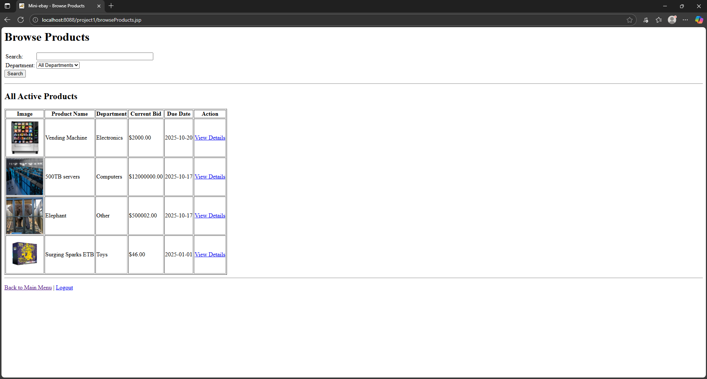
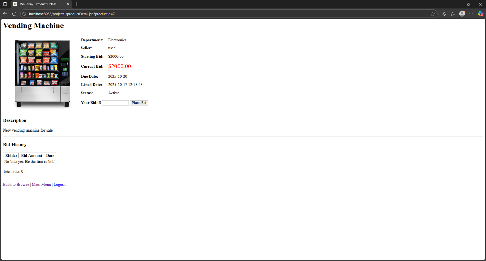
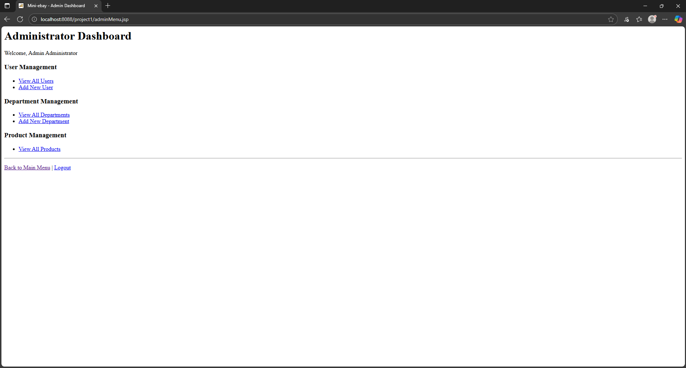
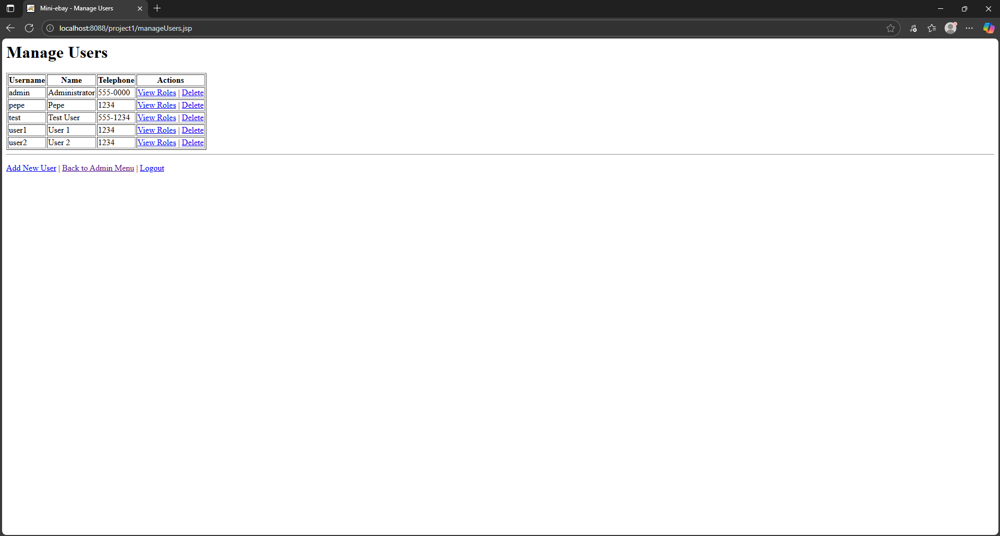

# Mini eBay (Web + Android)

Auction platform built for **Mobile, Web and Internet Programming (CPEN 410)** at Universidad Ana G. Méndez. Team of 2

Users can browse and search products by department, view bid history, place bids, and list items for sale. Admins manage users, departments, and products. A companion Android app uses the same backend (login, search, product detail, place bid).

## Tech stack
- Java Servlets / JSP on Apache Tomcat 11
- MySQL with JDBC
- SHA-256 hashed credentials
- Role-based access control (Admin / User), enforced per page through role-to-page and valid-navigation tables
- Android (Android Studio)

## Repository layout
```
database/schema.sql   MySQL schema and seed data (roles, departments, pages)
webapp/               Contents of Tomcat's webapps/ROOT (project1/ pages + WEB-INF/)
android-app/          Android Studio project
```

## Requirements
- JDK 17 or newer (required by Tomcat 11)
- Apache Tomcat 11.0.x (developed on 11.0.11)
- MySQL 9.4 (developed on 9.4.0)
- Libraries (not included). Download them and copy the JARs into `<tomcat>/lib` (or `webapp/WEB-INF/lib`):
  - MySQL Connector/J 8.0.19 (`mysql-connector-java-8.0.19.jar`)
  - Apache Commons Codec 1.11 (`commons-codec-1.11.jar`), used for SHA-256 hashing
  - Apache Commons IO 2.18.0 (`commons-io-2.18.0.jar`)
  - Apache Commons FileUpload 2.0.0-M2 (`commons-fileupload2-core-2.0.0-M2.jar` and `commons-fileupload2-jakarta-servlet5`), used for product image upload
  - org.json (`java-json.jar`), used for the Android JSON responses
- Android Studio (for the mobile app)

## Run the web app
1. Create the database: `mysql -u root -p < database/schema.sql`
2. Create a MySQL user with access to `project1` and set these environment variables **before starting Tomcat**: `DB_USER` and `DB_PASS` (required), and optionally `DB_URL` (defaults to `jdbc:mysql://localhost/project1`). See `MySQLCompleteConnector.java`.
3. Copy the contents of `webapp/` into `<tomcat>/webapps/ROOT/`, and put the JARs listed above in `<tomcat>/lib`.
4. Compile the Java sources in `WEB-INF/classes` (Windows, from that folder; `CATALINA` is your Tomcat folder):
   ```
   javac -cp ".;%CATALINA%\lib\servlet-api.jar;%CATALINA%\lib\mysql-connector-java-8.0.19.jar;%CATALINA%\lib\commons-codec-1.11.jar;%CATALINA%\lib\java-json.jar" *.java ut\CPEN410\*.java ut\JAR\CPEN410\*.java
   ```
5. Start Tomcat (`bin\startup.bat`) and open `http://localhost:8080/project1/loginHashing.html`.
6. Uploaded product images are saved to `project1/images/` inside the deployed app.

### Create the first admin
Passwords are stored as `SHA256(username + password)`. Run this, replacing `YOUR_PASSWORD`:
```sql
INSERT INTO usergood (UserName, hashing, Name, Telephone)
VALUES ('admin', SHA2(CONCAT('admin', 'YOUR_PASSWORD'), 256), 'Administrator', '555-0000');
INSERT INTO roleuser (UserName, RoleId, dateAssign) VALUES ('admin', 'ADMIN', CURDATE());
```

## Run the Android app
Open `android-app/` in Android Studio, the server address is the `hostAddress` field in `MainActivity`, `ProductListActivity` and `ProductDetailActivity` (default `10.0.2.2:8080`, which is the host machine as seen from the emulator; change it for a real device), and run on an emulator.

## Known limitations (this is a course project)
- SQL statements are built by string concatenation. A production version should use `PreparedStatement` to prevent SQL injection.
- Passwords use a plain SHA-256 hash of username + password. A production version should use a slow, salted algorithm such as bcrypt or Argon2.
- `ut.CPEN410` and the JDBC connector classes in `ut.JAR.CPEN410` are based on starter code provided by the course.

## Screenshots
| Browse products | Product detail and bidding |
|---|---|
|  |  |

| Admin dashboard | Manage users |
|---|---|
|  |  |
